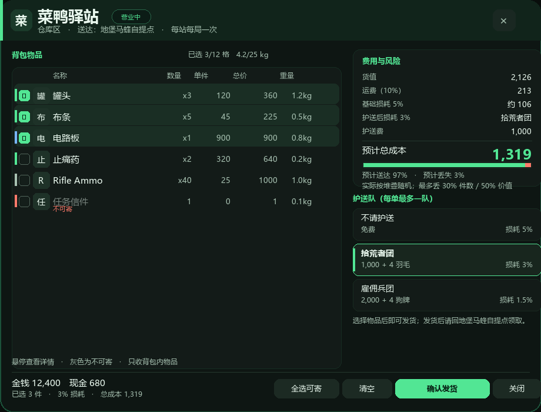
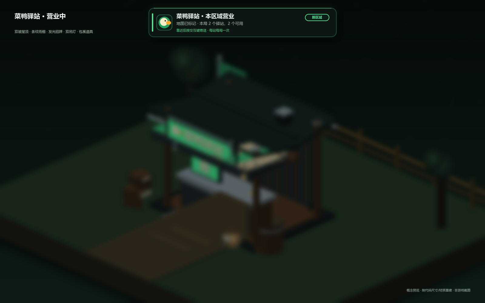
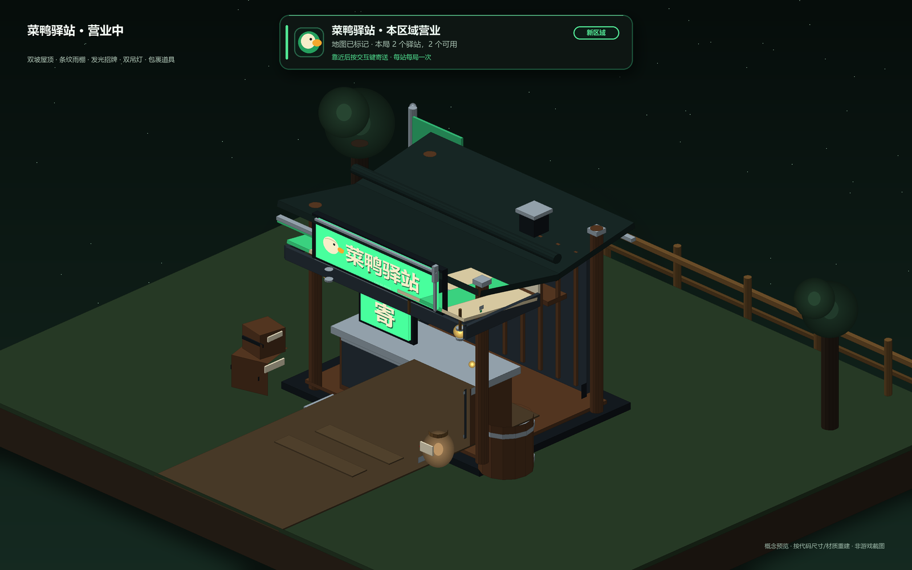
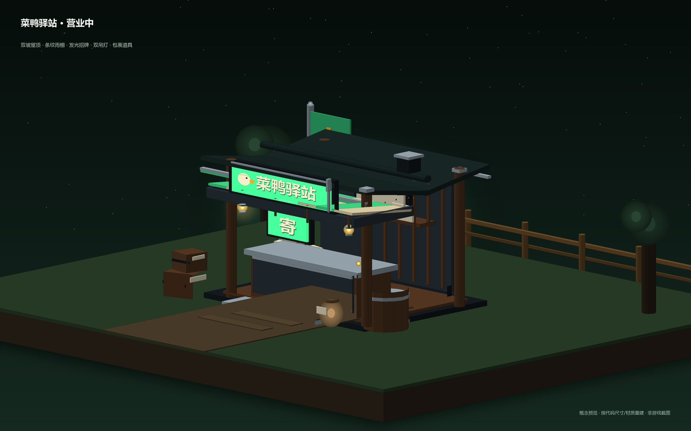
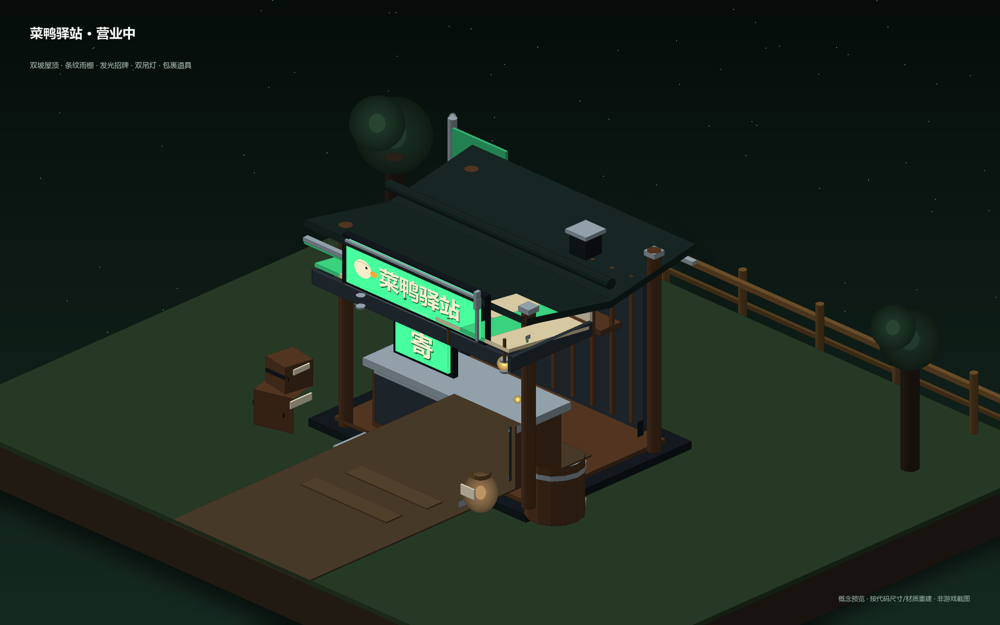
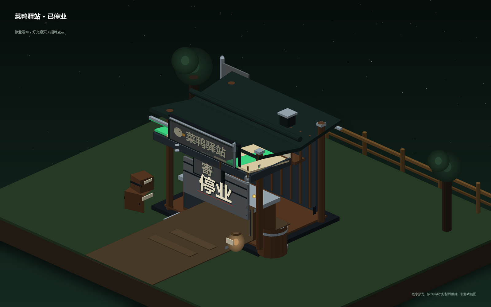

# 菜鸭驿站 0.1.0 界面预览

这是按实际布局参数生成的**静态设计预览**，不是游戏内截图。字体、分辨率、原生 UI 与材质会影响最终观感；实机仍以游戏内为准。

## 寄送面板（920 × 700 逻辑像素）

设计要点：

- **深绿黑底 + 荧光绿强调色**，和鸭子/搜打撤题材的“驿站”气质一致，避免纯黑面板的廉价感。
- 顶部是招牌区：鸭头图标、标题、营业中/已停业徽标、区域与送达说明、右上角关闭。
- 左列是物品清单：品质色条、物品图标、勾选框、名称、数量、单件价值、总价值、重量；整行可点击，悬停出现详情提示。
- 右列是决策区：货值与运费、基础/护送后损耗、护送费、预计总成本；下面用一条“送达/丢失”比例条把风险可视化，再列三张护送卡。
- 不可寄/费用不足/缓冲区不可用等原因在右列底部逐条写明，确认按钮同时置灰，不会出现“点了没反应”。
- 底部固定余额、已选摘要与“全选可寄 / 清空 / 确认发货 / 关闭”。

## 发货回执

回执改为结构化排版：顶部显示“已送达/全部丢失”徽标，四个信息块显示送达件数与价值、丢失件数与价值、运费、护送与损耗；下面左右两栏分别列“已送达”和“丢失”物品，底部是风味文本与关闭按钮。比纯文本回执更适合截图查账。

## 世界提示

- 80 米内、在画面中的驿站：显示带底板的“菜鸭驿站 42米”胶囊标签；停业后变灰。
- 在身后或画面外：屏幕边缘显示 `▲/▼/◀/▶ 菜鸭驿站 42米`，避免玩家只靠地图找。
- 公告/发货提示：顶部居中横幅，包含鸭头图标、标题、正文、提示语与右侧状态标签；从顶部滑入、淡出，支持最多 4 条排队。基地说明、发货完成、恢复和错误提示共用这套样式。

## 驿站模型

- 双坡屋顶、金属压边/屋脊、条纹雨棚、四根木柱、板墙、石面柜台、前挡板铜条。
- 正面檐板发光招牌：鸭头徽记 + `TextMesh` 招牌字；招牌字按招牌尺寸自动缩放，避免溢出。
- 双吊灯（一盏点光）、带鸭形图案的旗帜、货架/包裹、木箱、木桶、亚麻邮袋；停业时卷帘落下并显示“停业”。
- 开门时旗帜轻摆、吊灯呼吸、鸭头缓慢左右看；发货后旗帜/招牌变灰、吊灯熄灭、点光关闭。
- 全部由 Unity 基础几何体与游戏材质模板生成，不依赖外部模型/贴图；后续可整体替换为正式模型。

> 以上 5 张图为按代码尺寸/材质色重建的**概念预览**，不是游戏内截图；实机字体、光照、材质与相机角度会影响最终观感。预览生成脚本：[tools/mock_station_preview.py](../tools/mock_station_preview.py)。

## 交互保护

面板是 IMGUI 覆盖层，打开时会用独立 Harmony ID 拦截玩家侧的攻击、使用物品、拾取、丢弃、冲刺/瞄准和交互入口，关闭后延迟约 0.18 秒解除，避免“点关闭的那一下”仍然开枪。敌人 AI 不受影响，移动也不锁定，走远 6 米自动关闭。若补丁不可用且 `Safety.RequireInputGuard=true`，驿站面板会拒绝打开并提示原因。

货值达到 `Safety.ConfirmAboveValue`（默认 10000）或单件寄送时，确认按钮会先进入二次确认页；确认页显示货值、预计损耗、实际扣除和预计总成本，返回修改不会扣费。

## 已知视觉风险

- 运行时生成字体在部分系统上可能回退到 Arial，中文会缺字；日志会记录回退。驿站招牌的 `TextMesh` 按 Unity 默认可读面旋转 180° 面向 +Z；若实机出现镜像/背面，需要翻转 `localRotation`。
- 每个驿站新增约 100 个基础几何体、3 个 TextMesh 和 1 盏点光；两个驿站同屏时开销仍低，但低端机/大场景需观察帧率。
- 物品图标来自 `Item.Icon`，图集 Sprite 的 UV 在不同 Unity 版本可能有一像素偏差；实机若发现错位需要调整 `textureRect` 采样。
- 面板宽度按 920 逻辑像素设计；1280×720 下会按 0.8 缩放，仍可读；极小分辨率（如 1024×600）会拥挤。
- 面板打开时默认保存并强制显示/解锁光标，关闭恢复；若游戏每帧重新锁定光标，仍需改为原生 UI。
- 世界标签/边缘箭头基于主相机投影，切换相机或分屏未验证。
