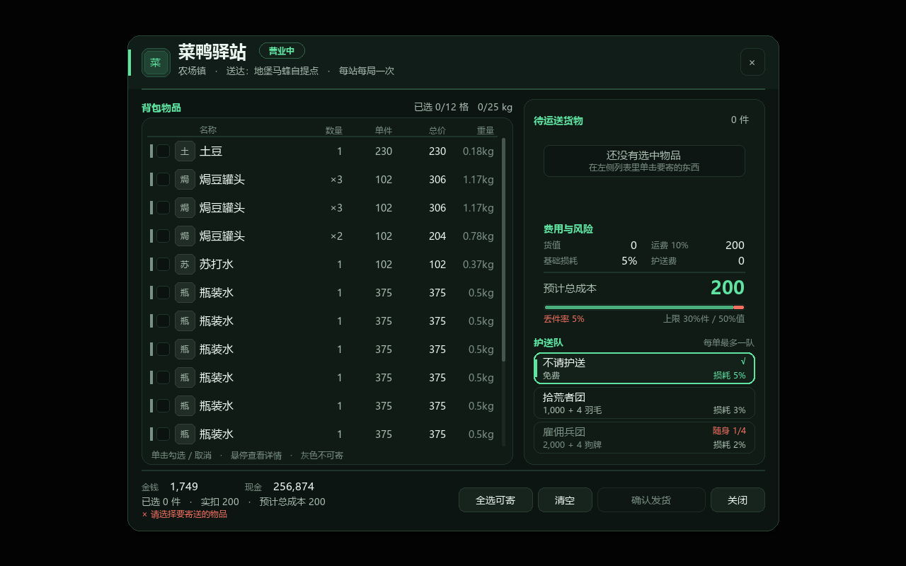
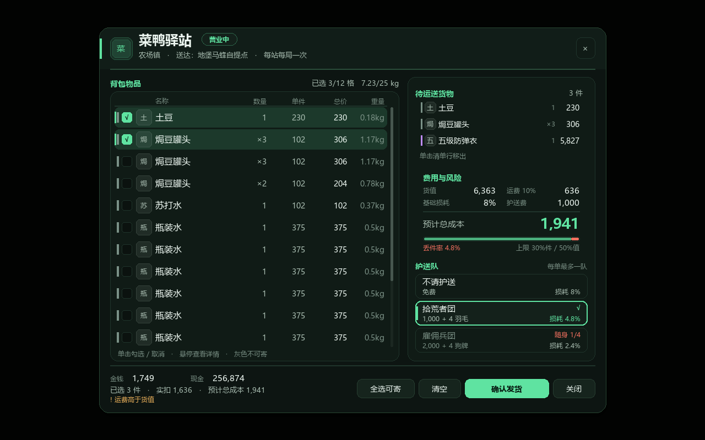
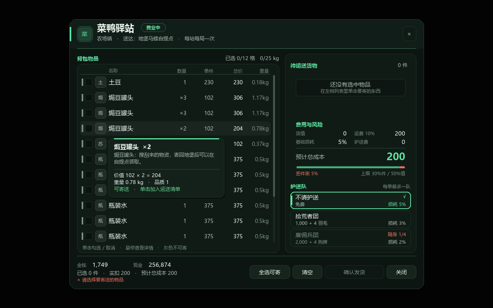

# 菜鸭驿站 0.1.0 界面预览

> 2026-10-23 更新：寄送面板已按度量式布局重做，下面的面板图**由真实布局代码离线渲染**（`tools/PanelPreview` 录制绘制指令 → `tools/render_panel_preview.py` 出图），几何与游戏内一致，只有字体光栅化不同（PIL/微软雅黑 vs Unity 动态字体）。驿站模型、世界提示仍是概念预览。

## 寄送面板（920 × 700 逻辑像素）

设计要点：

- **层次**：顶部招牌区（鸭头图标、标题、营业状态、区域/送达说明、关闭）；左列背包清单；右列一张连续的「运送单」卡片，从上到下是待运送货物、费用与风险、护送队；底部固定余额、摘要、状态与四个操作按钮。
- **可读性**：数字列右对齐且列宽固定（数量/单件/总价/重量）；选中行有薄荷色底、左侧竖条和勾选；不可寄的行变灰并在名称下方写明原因；悬停详情贴着当前行出现在它下方（放不下就翻到行上方），不遮住正在看的那一行，也不再压住右栏。
- **费用与风险**：货值/运费/基础损耗/护送费用 2×2 排布；「预计总成本」用大号强调；下方比例条把送达与丢件分开，图例给出丢件率与件数/价值上限。
- **护送队**：三张卡片（不请护送 / 拾荒者团 / 雇佣兵团），显示价格与随身材料；材料不足时右上角直接写「随身 1/4」，不会出现「点了没反应」。
- **状态栏**：被禁用时在左下角给出首要原因（其余原因计数），确认按钮同时置灰；抬头右侧显示件数，底部显示已选件数、实扣与预计总成本。

### 2026-10-23 修复：右栏文字重叠与悬停闪烁

上一版把右栏按固定 Y 偏移摆放（运送单 150、费用 168、提示区 `right.yMax - 88`），而费用卡内容实际需要约 185，提示区又压在第三张护送卡上，于是出现了「护送队」标题叠在损耗说明上、警告文字叠在「损耗 2%」上的现象。

- 右栏改成**单一纵向预算**：卡片高度从可用高度里扣除，运送单拿走剩余空间，三段之间只留固定间距；裁剪兜底，任何配置下都不会有两个分区抢占同一条带。
- 费用卡内部同样按行高排布，图例与上限各占一端，不再靠「差不多」的偏移。
- 面板高度下限从 600 提到 660，避免右栏在最矮配置下被截断。
- 布局改由 `src/CaiYaStation/PanelLayout.cs` 统一计算，`tools/PanelPreview` 会检查 5 种屏幕尺寸下「区块不重叠、文字不重叠、不超出面板」，并检查悬停详情不会盖住被悬停的行。

### 2026-10-23 修复：悬停闪烁

旧实现把行画在 `GUI.BeginScrollView` 里，再用「鼠标位置 − 视图原点 + 滚动量」反推行内坐标；IMGUI 在滚动区里已经把 `Event.mousePosition` 换成了内容坐标，两套换算叠在一起，命中区随滚动偏移漂移，悬停高亮和详情框就会来回闪。

- 面板不再使用 `GUI.BeginScrollView` / `GUI.Button`：滚动量自己维护，命中判定只用面板坐标系的矩形，和实际绘制的是同一批矩形。
- 悬停详情按行矩形定位（贴在行的下方或上方、横向夹在左栏内），只随「悬停到哪一行」变化，不跟鼠标像素抖动；高度按内容测一次后缓存，不会在两遍 OnGUI 里算出不同尺寸。
- 行悬停/选中由渲染器自己绘制，行按钮样式不再带 hover 背景，避免同一行出现两套互相打架的高亮。
- 列表每 0.5 秒刷新时先比对内容，内容没变就不换对象，悬停目标不会被动重置。

## 发货回执

回执改为结构化排版：顶部显示「已送达/全部丢失」徽标，四个信息块显示送达件数与价值、丢失件数与价值、运费、护送与损耗；下面左右两栏分别列「已送达」和「丢失」物品，底部是风味文本与关闭按钮。

发货丢件时会先弹「运送损失通知单」：肇事者吐槽 + 丢失清单 + 总损失 + 签收入口。这张单子也改成自上而下按内容高度排布，提示行与按钮不会再压在一起。

## 世界提示

- 80 米内、在画面中的驿站：显示带底板的「菜鸭驿站 42米」胶囊标签；停业后变灰。
- 在身后或画面外：屏幕边缘显示 `▲/▼/◀/▶ 菜鸭驿站 42米`，避免玩家只靠地图找。
- 公告/发货提示：顶部居中横幅，包含鸭头图标、标题、正文、提示语与右侧状态标签；从顶部滑入、淡出，支持最多 4 条排队。基地说明、发货完成、恢复和错误提示共用这套样式。

## 驿站模型

- 双坡屋顶、金属压边/屋脊、条纹雨棚、四根木柱、板墙、石面柜台、前挡板铜条。
- 正面檐板发光招牌：鸭头徽记 + `TextMesh` 招牌字；招牌字按招牌尺寸自动缩放，避免溢出。
- 双吊灯（一盏点光）、带鸭形图案的旗帜、货架/包裹、木箱、木桶、亚麻邮袋；停业时卷帘落下并显示「停业」。
- 开门时旗帜轻摆、吊灯呼吸、鸭头缓慢左右看；发货后旗帜/招牌变灰、吊灯熄灭、点光关闭。
- 全部由 Unity 基础几何体与游戏材质模板生成，不依赖外部模型/贴图；后续可整体替换为正式模型。

> 驿站与提示图仍为按代码尺寸/材质色重建的**概念预览**，不是游戏内截图；实机字体、光照、材质与相机角度会影响最终观感。预览生成脚本：[tools/mock_station_preview.py](../tools/mock_station_preview.py)。

## 交互保护

面板是 IMGUI 覆盖层，打开时会用独立 Harmony ID 拦截玩家侧的攻击、使用物品、拾取、丢弃、冲刺/瞄准和交互入口，关闭后延迟约 0.18 秒解除，避免「点关闭的那一下」仍然开枪。敌人 AI 不受影响，移动也不锁定，走远 6 米自动关闭。若补丁不可用且 `Safety.RequireInputGuard=true`，驿站面板会拒绝打开并提示原因。

货值达到 `Safety.ConfirmAboveValue`（默认 10000）或单件寄送时，确认按钮会先进入二次确认页；确认页显示货值、预计损耗、实际扣除和预计总成本，返回修改不会扣费。

## 已知视觉风险

- 运行时生成字体在部分系统上可能回退到 Arial，中文会缺字；日志会记录回退。驿站招牌的 `TextMesh` 按 Unity 默认可读面旋转 180° 面向 +Z；若实机出现镜像/背面，需要翻转 `localRotation`。
- 每个驿站新增约 100 个基础几何体、3 个 TextMesh 和 1 盏点光；两个驿站同屏时开销仍低，但低端机/大场景需观察帧率。
- 物品图标来自 `Item.Icon`，图集 Sprite 的 UV 在不同 Unity 版本可能有一像素偏差；实机若发现错位需要调整 `textureRect` 采样。预览图里用名称首字占位。
- 面板宽度按 920 逻辑像素设计；1280×720 下会按 0.8 缩放，仍可读；面板高度低于 660 时右栏会被裁切，`config.json` 已限制该范围。
- 面板打开时默认保存并强制显示/解锁光标，关闭恢复；若游戏每帧重新锁定光标，仍需改为原生 UI。
- 世界标签/边缘箭头基于主相机投影，切换相机或分屏未验证。
