# 菜鸭驿站 0.1.0 界面预览

> 2026-10-23 更新：寄送面板已按度量式布局重做，下面的面板图**由真实布局代码离线渲染**（`tools/PanelPreview` 录制绘制指令 → `tools/render_panel_preview.py` 出图），几何与游戏内一致，只有字体光栅化不同（PIL/微软雅黑 vs Unity 动态字体）。驿站模型、世界提示仍是概念预览。

## 寄送面板（920 × 700 逻辑像素）

> 2026-10-31：整体换成浅灰蓝 / 冷白 / 薄荷绿配色（`PanelPalette` 与 `UiTheme` 共用同一套色值），下列图由浅色主题重新离线渲染。

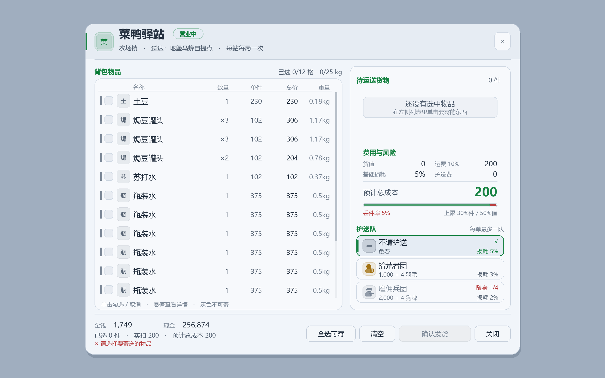

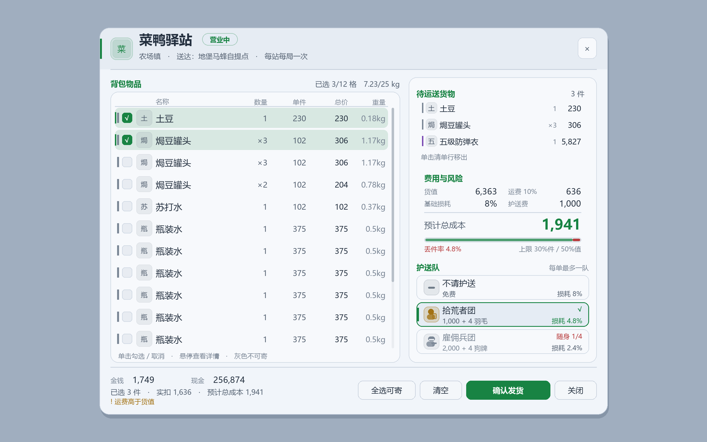

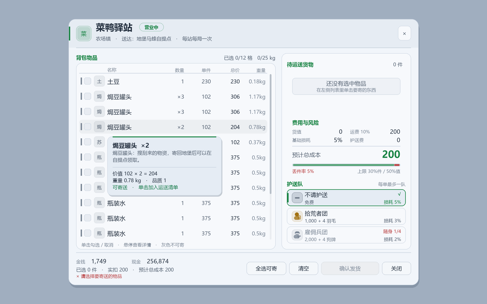

设计要点：

- **层次**：顶部招牌区（鸭头图标、标题、营业状态、区域/送达说明、关闭）；左列背包清单；右列一张连续的「运送单」卡片，从上到下是待运送货物、费用与风险、护送队；底部固定余额、摘要、状态与四个操作按钮。
- **可读性**：数字列右对齐且列宽固定（数量/单件/总价/重量）；选中行有薄荷色底、左侧竖条和勾选；不可寄的行变灰并在名称下方写明原因；悬停详情贴着当前行出现在它下方（放不下就翻到行上方），不遮住正在看的那一行，也不再压住右栏。
- **费用与风险**：货值/运费/基础损耗/护送费用 2×2 排布；「预计总成本」用大号强调；下方比例条把送达与丢件分开，图例给出丢件率与件数/价值上限。
- **护送队**：三张卡片（不请护送 / 拾荒者团 / 雇佣兵团），每张卡左侧一枚 28×28 自绘徽章（拾荒者=暖黄兜帽人+背包、雇佣兵=蓝灰头盔人+横枪、不请护送=横杠；拿不到时整枚转灰），显示价格与随身材料；材料不足时右上角直接写「随身 1/4」，不会出现「点了没反应」。
- **清单**：右栏「待运送货物」逐行显示图标、名称、数量与总值，单击移出；裁剪组按绝对坐标换算偏移，嵌套分区（运送单在右栏卡片内部）不会把行推出可视区。
- **状态栏**：被禁用时在左下角给出首要原因（其余原因计数），确认按钮同时置灰；抬头右侧显示件数，底部显示已选件数、实扣与预计总成本。

### 2026-10-23 修复：右栏文字重叠与悬停闪烁

上一版把右栏按固定 Y 偏移摆放（运送单 150、费用 168、提示区 `right.yMax - 88`），而费用卡内容实际需要约 185，提示区又压在第三张护送卡上，于是出现了「护送队」标题叠在损耗说明上、警告文字叠在「损耗 2%」上的现象。

- 右栏改成**单一纵向预算**：卡片高度从可用高度里扣除，运送单拿走剩余空间，三段之间只留固定间距；裁剪兜底，任何配置下都不会有两个分区抢占同一条带。
- 费用卡内部同样按行高排布，图例与上限各占一端，不再靠「差不多」的偏移。
- 面板高度下限从 600 提到 660，避免右栏在最矮配置下被截断。
- 布局改由 `src/CaiYaStation/PanelLayout.cs` 统一计算，`tools/PanelPreview` 会检查 5 种屏幕尺寸下「区块不重叠、文字不重叠、不超出面板」，并检查悬停详情不会盖住被悬停的行。

### 2026-10-23 修复：悬停闪烁

旧实现把行画在 `GUI.BeginScrollView` 里，再用「鼠标位置 − 视图原点 + 滚动量」反推行内坐标；IMGUI 在滚动区里已经把 `Event.mousePosition` 换成了内容坐标，两套换算叠在一起，命中区随滚动偏移漂移，悬停高亮和详情框就会来回闪。

- 面板不再使用 `GUI.BeginScrollView` / `GUI.Button`：滚动量自己维护，命中判定只用面板坐标系的矩形，和实际绘制的是同一批矩形。
- 悬停详情按行矩形定位（贴在行的下方或上方、横向夹在左栏内），只随「悬停到哪一行」变化，不跟鼠标像素抖动；高度按内容测一次后缓存，不会在两遍 OnGUI 里算出不同尺寸。
- 行悬停/选中由渲染器自己绘制，行按钮样式不再带 hover 背景，避免同一行出现两套互相打架的高亮。
- 列表每 0.5 秒刷新时先比对内容，内容没变就不换对象，悬停目标不会被动重置。

### 2026-11-01 修复：清单整片空白与护送队徽章

实机反馈右栏「待运送货物」标题和「7 件」计数都在、列表区却完全空白。根因是裁剪组偏移：`GuiPanelPainter.BeginClip` 用 `_offset += rect.position` 累加，而 `Offset(rect)` 又用 `rect - _offset` 换算——`DrawRail` 外层开过一次 `RailCard` 组、`DrawManifest` 内层再开 `ManifestView` 组，第二层把父偏移加了两遍，清单每一行都被多减一个 `RailCard.position`，整片被推出裁剪区。左列列表与 rail 外层是单层组，所以一直正常。改为 `_offset = rect.position`（`rect` 恒为绝对屏幕矩形），`EndClip` 仍从栈里恢复。

同一轮还给护送队三张卡加了图标。先确认游戏侧没有官方人物立绘可用：`Managed` 全目录扫 `Portrait`/`ActorPortrait`/`Avatar` 零命中，`TeamSoda.Duckov.Core.dll` 只有 `actorPortraitContainer`/`get_portraitSprite`/`get_MerchantCharacterIcon` 这类 UI 组件与属性名，`CharacterIconTypes` 只是分类枚举，`SpritesData.GetSprite(key)` 的 `get_Default()` 是 Private Static。于是改用面板自己的 `Rounded`/`Solid` 原语画 28×28 徽章，与鸭子贴纸同一套描边+外晕语言，零资源依赖；标题与费用左边界让到 `rect.x + 47f` 以避开徽章。

## 运输回执

> 2026-10-31 重做：与寄送面板共用同一套浅色主题与鸭子贴纸徽标，物品行改用游戏原生图标（`ItemAssetsCollection.GetMetaData(typeId).icon`，缺图标时用统一占位并在日志记一次原因）。

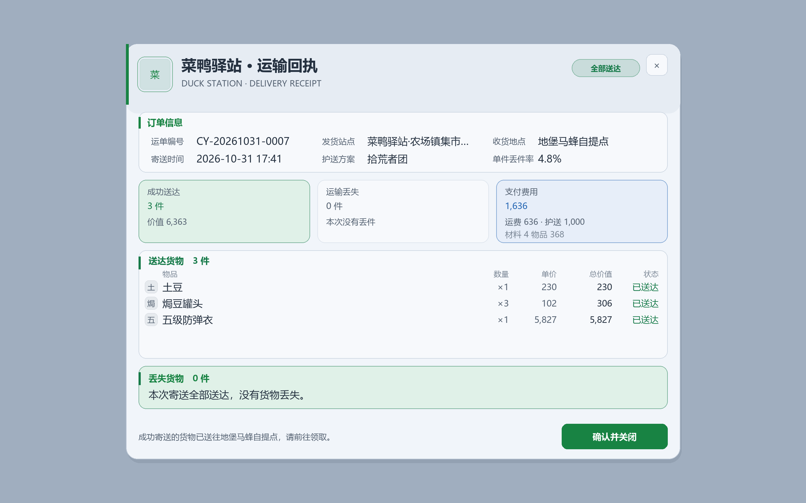

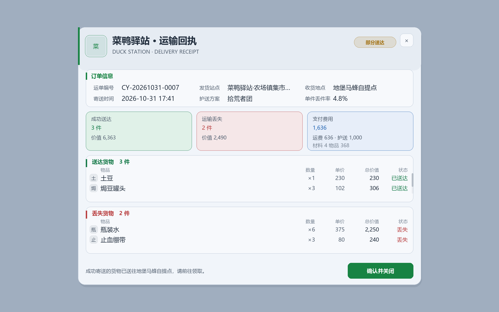

排版要点：

- **抬头**：左侧 4px 强调竖条 + 56px 鸭子贴纸徽标框；标题「菜鸭驿站 · 运输回执」，副标题 `DUCK STATION · DELIVERY RECEIPT`；右侧三态徽章（全部送达=薄荷绿 / 部分送达=琥珀 / 全部丢失=柔和红）与关闭按钮。
- **订单信息卡**：运单编号、发货站点（站点名 + 地图）、收货地点（地堡马蜂自提点）、寄送时间（`CreatedUtc` 转本地）、护送方案、单件丢件率，6 项 3 列 2 行。
- **三张统计卡**：成功送达（浅绿）、运输丢失（浅红，无损失时写「本次没有丢件」）、支付费用（浅蓝，现金拆分运费/护送，材料消耗单独一行；旧回执没有材料字段时显示「材料消耗未记录」，不按当前护送价推测）。
- **两张货物表**：每行 图标 / 名称 / 数量 / 单价 / 总价值 / 状态，各自独立滚动（滚轮只作用于鼠标所在的那张表），裁剪区按整行取整，不会露出半行；丢失为空时用绿卡写「本次寄送全部送达，没有货物丢失。」
- **底部**：左侧说明「成功寄送的货物已送往地堡马蜂自提点，请前往领取。」，右侧深绿「确认并关闭」。这里**没有**「领取」按钮——货物在发货时已由 `PlayerStorage.Push()` 进到货缓冲区，回执只负责确认，不会重复发放。

回执的最终状态是从堆叠列表推导的三态（`Delivered` 空→全部丢失、`Lost` 空→全部送达、都有→部分送达），不参与结算。

## 运送损失通知单

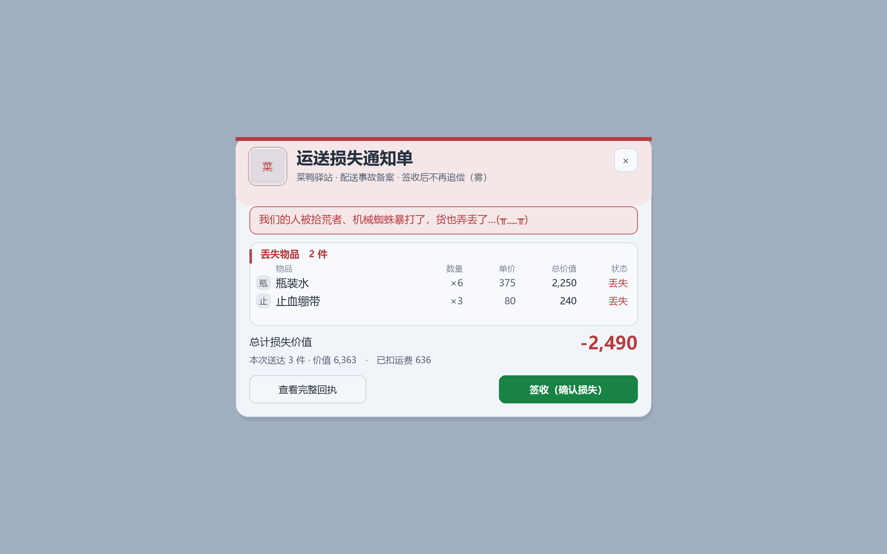

丢件时先弹这张单子：柔和红抬头 + 红色趣味文案（肇事者与颜文字取自回执已存字段 `LossCulprits`/`LossKaomoji`，不重新随机）+ 丢失物品表 + 总计损失价值 + 「本次送达 N 件 · 价值 X · 已扣运费 Y」，底部「查看完整回执」与「签收（确认损失）」。两个按钮与 Esc 都只是切到回执，不改结算结果。

## 世界提示

- 80 米内、在画面中的驿站：显示带底板的「菜鸭驿站 42米」胶囊标签；停业后变灰。
- 在身后或画面外：屏幕边缘显示 `▲/▼/◀/▶ 菜鸭驿站 42米`，避免玩家只靠地图找。
- 公告/发货提示：顶部居中横幅，包含鸭头图标、标题、正文、提示语与右侧状态标签；从顶部滑入、淡出，支持最多 4 条排队。基地说明、发货完成、恢复和错误提示共用这套样式。

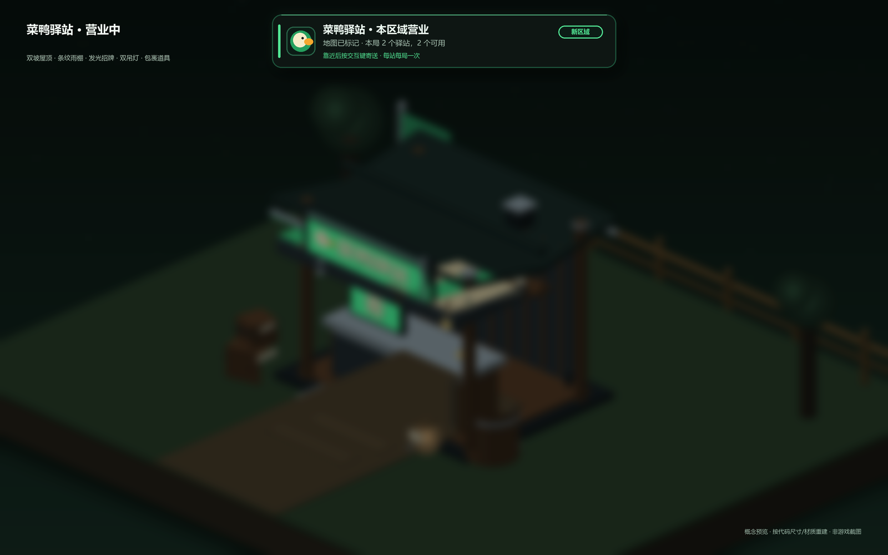

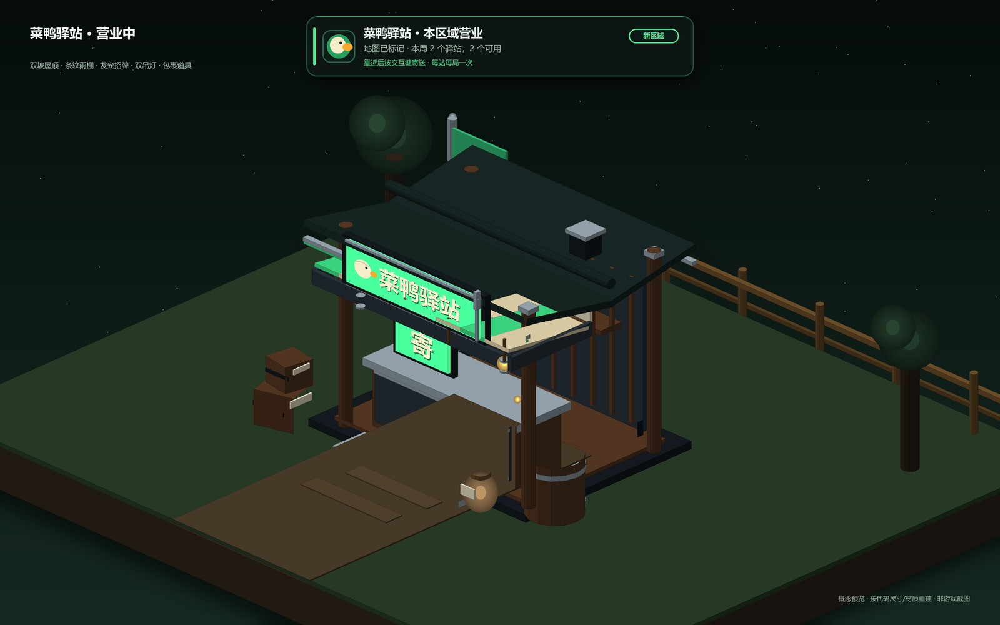

## 驿站模型

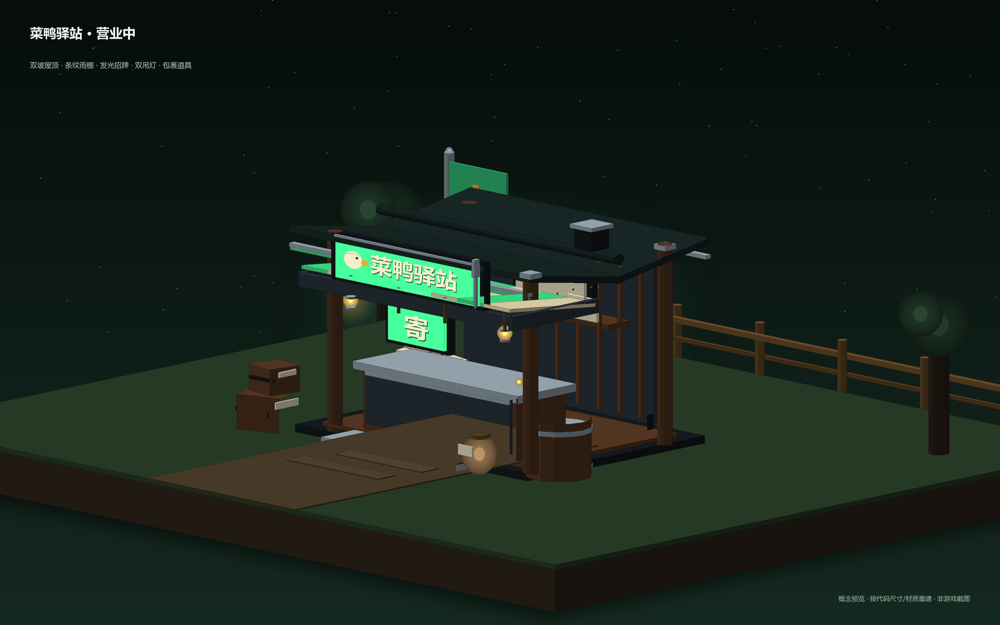

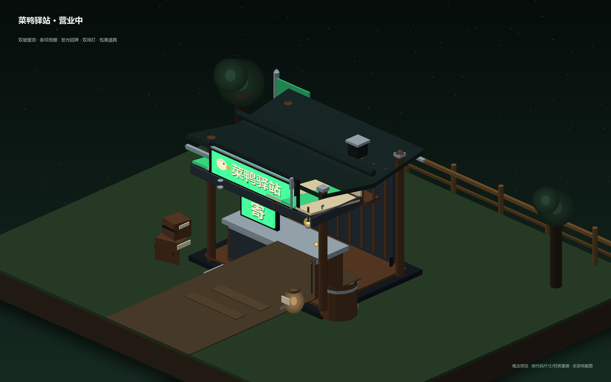

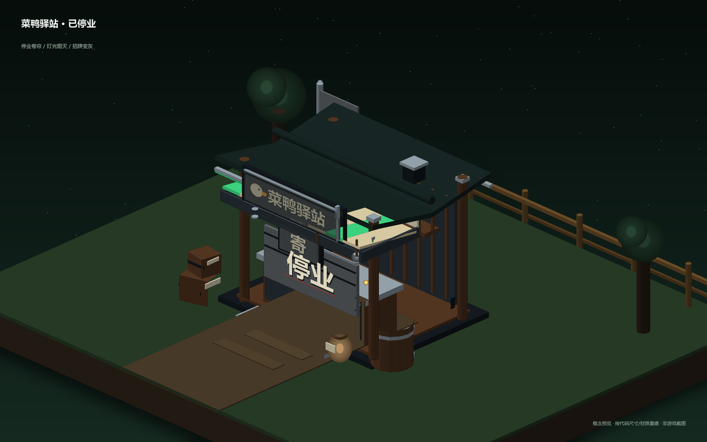

- 双坡屋顶、金属压边/屋脊、条纹雨棚、四根木柱、板墙、石面柜台、前挡板铜条。
- 正面檐板发光招牌：鸭头徽记 + `TextMesh` 招牌字；招牌字按招牌尺寸自动缩放，避免溢出。
- 双吊灯（一盏点光）、带鸭形图案的旗帜、货架/包裹、木箱、木桶、亚麻邮袋；停业时卷帘落下并显示「停业」。
- 开门时旗帜轻摆、吊灯呼吸、鸭头缓慢左右看；发货后旗帜/招牌变灰、吊灯熄灭、点光关闭。
- 全部由 Unity 基础几何体与游戏材质模板生成，不依赖外部模型/贴图；后续可整体替换为正式模型。

> 驿站与提示图仍为按代码尺寸/材质色重建的**概念预览**，不是游戏内截图；实机字体、光照、材质与相机角度会影响最终观感。预览生成脚本：[tools/mock_station_preview.py](../tools/mock_station_preview.py)。

## 交互保护

面板是 IMGUI 覆盖层，打开时会用独立 Harmony ID 拦截玩家侧的攻击、使用物品、拾取、丢弃、冲刺/瞄准和交互入口，关闭后延迟约 0.18 秒解除，避免「点关闭的那一下」仍然开枪。敌人 AI 不受影响，移动也不锁定，走远 6 米自动关闭。若补丁不可用且 `Safety.RequireInputGuard=true`，驿站面板会拒绝打开并提示原因。

货值达到 `Safety.ConfirmAboveValue`（默认 10000）或单件寄送时，确认按钮会先进入二次确认页；确认页显示货值、预计损耗、实际扣除和预计总成本，返回修改不会扣费。

## 已知视觉风险

- 运行时生成字体在部分系统上可能回退到 Arial，中文会缺字；日志会记录回退。驿站招牌的 `TextMesh` 按 Unity 默认可读面旋转 180° 面向 +Z；若实机出现镜像/背面，需要翻转 `localRotation`。
- 每个驿站新增约 100 个基础几何体、3 个 TextMesh 和 1 盏点光；两个驿站同屏时开销仍低，但低端机/大场景需观察帧率。
- 物品图标来自 `Item.Icon`，图集 Sprite 的 UV 在不同 Unity 版本可能有一像素偏差；实机若发现错位需要调整 `textureRect` 采样。预览图里用名称首字占位。
- 面板宽度按 920 逻辑像素设计；1280×720 下会按 0.8 缩放，仍可读；面板高度低于 660 时右栏会被裁切，`config.json` 已限制该范围。
- 面板打开时默认保存并强制显示/解锁光标，关闭恢复；若游戏每帧重新锁定光标，仍需改为原生 UI。
- 世界标签/边缘箭头基于主相机投影，切换相机或分屏未验证。
